# Thoth Sphinx

**An agentic, multimodal RAG system that reads Egyptian hieroglyphs from a photograph.**

A vision pipeline turns a photo of a carved wall into a query. A Claude agent then searches four hybrid indexes (full text + pgvector, fused by RRF, Cohere rerank), a sign-spelling lexicon that proposes one-edit corrections to the detector's reading, and a curated knowledge graph. A deterministic router escalates weak readings to a stronger model, an evidence check makes sure every line is backed by the corpus, the visitor can correct a sign and have the wall re-read, and a final generate-then-retrieve step grounds the translation in published scholarship. Every retrieval decision was measured against a golden set.


Six months of work, from a 224 × 224 classifier of single signs to a reading agent. The project combines:

| Field | Where it lives |
|---|---|
| **Computer vision** | YOLO11-Large detector trained in nine curriculum generations, from one sign per 224 px image to dense walls at 1024 px |
| **Spatial logic** | quadrat clustering, line assembly, cartouche membership, reading direction |
| **Classic NLP + data structures** | lexicon trie, bigram language model, Viterbi segmentation, Needleman-Wunsch alignment, symmetric-delete spelling index |
| **Modular RAG** | six retrievers over PostgreSQL + pgvector, hybrid search, reciprocal rank fusion, reranking, a knowledge graph |
| **Agentic LLM flow** | Claude tool loops, a deterministic router, model escalation, an editor, human-in-the-loop corrections, session state and memory |
| **Product** | FastAPI + React app, the Thot-Sphinx persona, a riddle trial and a carved royal-cartouche reward |

Live site: [sphinx.tensorgeek.com](https://sphinx.tensorgeek.com) (the backend is offline between demos; ask for one).

---

## Contents

1. [The problem](#1-the-problem)
2. [Architecture](#2-architecture)
3. [The RAG design](#3-the-rag-design)
4. [The agent](#4-the-agent)
5. [Decisions from measurements](#5-decisions-from-measurements)
6. [Computer vision](#6-computer-vision)
7. [Classic NLP and data structures](#7-classic-nlp-and-data-structures)
8. [Thot-Sphinx: persona, riddles and the cartouche gift](#8-thot-sphinx-persona-riddles-and-the-cartouche-gift)
9. [The app](#9-the-app)
10. [Guardrails](#10-guardrails)
11. [Stack](#11-stack)
12. [Running it](#12-running-it)
13. [Repository layout](#13-repository-layout)
14. [Attribution and licence](#14-attribution-and-licence)
15. [Roadmap](#15-roadmap)

---

## 1. The problem

Automated reading of Middle Egyptian inscriptions is non-trivial. Glyphs appear in dense, multi-row or multi-column layouts carved or painted on stone; individual signs are visually similar across dozens of Gardiner classes; reading direction (left-to-right vs right-to-left, horizontal vs vertical) is set by the orientation of figurative signs rather than by a fixed convention; and many signs sit inside cartouches, oval enclosures that frame royal names, whose interior must be treated as an independent reading unit.

Reading a hieroglyphic wall is hard at every layer:

- **Seeing.** Hundreds of Gardiner sign classes, many nearly identical (G1 vulture / G5 falcon, N5 sun / N33 grain / Aa1 placenta), carved in low relief on weathered stone and photographed in bad light.
- **Ordering.** Signs are grouped in *quadrats*, written in rows or columns, left-to-right or right-to-left, and the direction is given by which way the animals face, not by any fixed rule.
- **Royal names.** Kings' names sit inside *cartouches*, ovals that must be read as their own unit and matched against known names.
- **Meaning.** A transliteration is not a translation. A good reading needs attested parallels, a dictionary, knowledge of who the king was, and the published scholarship on the text.

Thoth Sphinx answers with three outputs for every photo:

1. a **Leiden transliteration** of every line,
2. a **gloss translation** with notes in the voice of the Reader of Stones, marking doubt with `(?)`, `( )` and `[...]`,
3. a **grounded translation**, rewritten against published translations of the same text, with citations, and the raw translation kept beside it.

---

## 2. Architecture

```mermaid
%%{init: {"theme": "dark", "themeVariables": {"fontFamily": "Georgia, serif", "fontSize": "14px", "lineColor": "#d4a017", "clusterBkg": "#14110a", "clusterBorder": "#b8860b"}, "flowchart": {"curve": "basis", "nodeSpacing": 22, "rankSpacing": 38}}}%%
flowchart LR
    classDef seeker fill:#3b2a10,stroke:#f59e0b,stroke-width:2px,color:#fde68a
    classDef vision fill:#0f2533,stroke:#38bdf8,stroke-width:1.5px,color:#e0f2fe
    classDef llm fill:#3f1d38,stroke:#f472b6,stroke-width:2.5px,color:#fce7f3
    classDef code fill:#1e1b4b,stroke:#a78bfa,stroke-width:1.5px,color:#ede9fe
    classDef store fill:#0f2e1f,stroke:#34d399,stroke-width:1.5px,color:#d1fae5
    classDef guard fill:#3a0d0d,stroke:#f87171,stroke-width:1.5px,color:#fee2e2
    classDef out fill:#4a3205,stroke:#fbbf24,stroke-width:3px,color:#fef3c7

    subgraph S1["① QUERY"]
        direction TB
        IMG["📷 Wall photo"]:::seeker
        OPT["🧭 Layout · direction"]:::seeker
        CTX["𓊹 Context<br/>period · site · reign"]:::seeker
    end

    subgraph S2["② VISION · deterministic"]
        direction TB
        DET["👁️ YOLO11l v9C<br/>letterbox 1024 · 150 classes<br/>top-3 per sign"]:::vision
        ORD["Reading order<br/>cartouche tagging · quadrats · lines"]:::vision
        CM["Cartouche matcher<br/>Needleman-Wunsch · 41 kings"]:::vision
    end

    CARDS["③ 🪪 Entity cards<br/>cartouche → royal name<br/>→ pharaoh"]:::code

    subgraph S4["④ AGENTIC READ"]
        direction TB
        WALL["🧠 Reader · Haiku 5.5<br/>photo + all lines + cartouches<br/>+ context + KG + corrections"]:::llm
        CHUNK["Haiku per chunk<br/>long walls · ≤ 40 codes"]:::llm
        HUB{{"🔁 Tool loop<br/>≤ 3 turns · ≤ 12 parallel calls"}}:::code
        EVC["✅ Evidence check<br/>search every skipped line"]:::code
        RT{"⚖️ Deterministic<br/>router"}:::code
        SON["🔍 Reviewer · Sonnet 5.5<br/>2 tool turns · checks the draft"]:::llm
        WALL <--> HUB
        WALL --> EVC --> RT
        RT -->|"escalate"| SON
        SON <--> HUB
    end

    subgraph STORE["🗄️ EVIDENCE STORE · Postgres + pgvector · hybrid RRF"]
        direction TB
        TLA[("TLA · 104k sentences")]:::store
        LEM[("Lemmas · AAEW")]:::store
        VOC[("Vocabulary<br/>one-edit spellings")]:::store
        KG[("Knowledge graph")]:::store
        TRN[("Published translations<br/>Allen · Faulkner · Piankoff")]:::store
        BK[("17 Egyptology books")]:::store
    end

    DRAFT["⑤ 📜 READING<br/>transliteration<br/>gloss translation · notes"]:::out

    subgraph S6["⑥ SEMANTIC REFINEMENT · generate-then-retrieve"]
        direction TB
        STR["search_translations<br/>raw translation as query · king filter<br/>name variants · group by spell · Cohere rerank"]:::code
        ED["✍️ Editor · Haiku 5.5<br/>same_text · related · none"]:::llm
        STR --> ED
    end

    FINAL["🏛️ FINAL ANSWER<br/>transliteration · gloss<br/>+ grounded translation<br/>with citations"]:::out

    subgraph S7["⑦ HUMAN IN THE LOOP"]
        direction TB
        RCH["💬 Reading chat · Haiku 5.5<br/>proposes corrections<br/>checked against the snapshot"]:::llm
        APP["👤 Apply & re-read<br/>≤ 3 signs · 1 per hour"]:::seeker
        SES[("Session ledger<br/>versions")]:::store
        RCH --> APP
        APP -.-> SES
    end

    GRD["🛡️ Guardrails<br/>input caps · rate limits<br/>$3 / day budget · injection fence"]:::guard

    IMG --> DET --> ORD --> CM --> CARDS
    OPT -.-> ORD
    KG -.-> CARDS
    CARDS -->|"KG block"| WALL
    ORD -->|"≤ 120 codes"| WALL
    ORD -->|"> 120"| CHUNK
    IMG -.->|"photo"| WALL
    CTX -.-> WALL
    GRD -.- WALL

    HUB <-->|"search_parallels"| TLA
    HUB <-->|"lookup_lemma"| LEM
    HUB <-->|"lookup_signs"| VOC
    HUB <-->|"lookup_entity"| KG

    RT -->|"confident"| DRAFT
    SON --> DRAFT
    CHUNK --> DRAFT
    DRAFT --> STR
    STR <--> TRN
    ED --> FINAL

    FINAL --> RCH
    RCH <-->|"search_books"| BK
    RCH <-->|"lookup_signs"| VOC
    APP ==>|"HUMAN CORRECTIONS · re-read"| WALL
```



**Legend:** amber = seeker / input · blue = vision (deterministic) · pink = Claude call · violet = code (tools, router, checks) · green = data store · red = guardrail · gold = output. Solid arrows = data flow, dotted = side input, thick = the human-correction re-read.

**The two-stage web flow.** The browser fires detection (`POST /predict/`) the moment the seeker picks a reading direction. While they fill in the archaeological context (about 10 s), the detector finishes, so "Decode" only waits on the agent read (`POST /transliterate/`).

---

## 3. The RAG design

In the terms of the RAG survey by Gao et al. (2023), which runs from Naive to Advanced to **Modular** RAG, Thoth Sphinx is **Modular RAG**: search, fusion, rerank, routing, memory and verification are separate modules arranged into a custom flow. Its main pattern is **agentic RAG**.

| Part of Thoth Sphinx | RAG pattern |
|---|---|
| The question is a **photo**: YOLO turns it into Gardiner codes, and Claude also sees the photo itself | **Multimodal RAG** (the query is built from an image) |
| **Retrievers:** TLA sentences (sign + transliteration n-grams), lemmas, sign spellings, 17 Egyptology books, published spell translations (Allen, Faulkner, Piankoff / Brown), a knowledge graph | **Multi-source / federated RAG** |
| TLA, books and translations each combine full-text search with pgvector, fused by **reciprocal rank fusion (RRF)** | **Hybrid RAG** |
| Cohere rerank, grouping by spell, name-variant query fusion (Unas / Unis / Wenis), small-to-big | **Advanced RAG** post-retrieval steps |
| **Vocabulary lookup** (`lookup_signs`): codes → attested words spelled with those signs, plus spellings one edit away (a misread, missing, extra or transposed sign) with attestation counts | **Lexicon-grounded retrieval as error correction**: the retriever checks and repairs the *query* (the detector's reading), not just the answer |
| Haiku chooses its own tools, calls them in parallel, within a turn budget | **Agentic RAG** |
| The router escalates to Sonnet; the evidence check searches lines the model skipped; a human correction triggers a re-read | **Corrective / self-reflective RAG + human in the loop** |
| Second translation: generate → search with the generation → rewrite against published translations | **Generate-then-retrieve** (close to **HyDE** and **RARR**) |
| Entity cards: cartouche → royal name → pharaoh, from a curated graph, given to the prompt before the read | **Knowledge-graph-augmented RAG** (entity linking and lookup) |
| Server reading sessions, a corrections ledger, browser memory, seeker memory | **Stateful agent** around the RAG |

**What it is not.**

- **Not Microsoft GraphRAG.** GraphRAG has an LLM extract a graph from the whole corpus, then answers broad questions from community summaries. Ours is a **curated** graph used for entity lookup, and it is treated as background, never as evidence.
- **Not conventional RAG** (top-k → prompt → one generation). Retrieval happens before, during and after generation, and code, not the model, decides when to escalate.

### The evidence store

PostgreSQL 16 + pgvector, in Docker.

| Store | Content | Search |
|---|---|---|
| **TLA corpus** | Thesaurus Linguae Aegyptiae (AAEW): 32,336 documents, 104,285 sentences, about 792,000 tokens | sign n-grams + transliteration n-grams, hybrid RRF, optional Cohere rerank |
| **Lemmas** | 38,775 dictionary entries | transliteration or English gloss |
| **Vocabulary** | Middle Egyptian spellings (texts dated First Intermediate Period to Second Intermediate Period), `sign_spellings` + a one-sign-deleted index | exact and one-edit lookup |
| **Knowledge graph** | gods, pharaohs, royal names, dynasties, temples, pyramids, with links into lemmas and dated texts | entity lookup |
| **Published translations** | Allen's Pyramid Texts, Faulkner's Coffin Texts, Piankoff's *Pyramid of Unas* | hybrid RRF + Cohere rerank, grouped by spell |
| **Egyptology books** | 17 books, 5,107 chunks of 224–640 tokens | hybrid RRF (full text + `text-embedding-3-small`) |

The same tools are also exposed as an **MCP server** (`corpus/mcp_server.py`).

---

## 4. The agent

All LLM calls go through one wrapper, `app/llm/client.py` (Anthropic SDK). It caches the system prompt, sets effort per feature, returns typed pydantic replies, meters cost and latency on every call, and raises typed errors (`LLMRefusal`, `LLMTruncated`, `LLMUnavailable`, `LLMRequestError`).

### The read, step by step

1. **Entity cards first.** Each matched cartouche is followed through the graph: cartouche label → `royal_name` entity → its `names` link → `pharaoh`. The cards become a KNOWLEDGE GRAPH block in the prompt. They are never looked up by transliteration, because `mn-xpr-ra` would match the god Ra.
2. **One multimodal call.** A wall of up to 120 codes is read in a single call by **Claude Haiku 5.5**: the photo, every line, the cartouches (matched and unresolved), the archaeological context, the graph block and any human corrections. Longer walls are read in chunks of up to 40 codes, cut at line boundaries.
3. **Tool loop.** A hand-written loop (`complete_parsed_with_tools`) gives Haiku 3 turns. Each turn may make up to 12 calls, run in parallel on 4 workers, each with its own database connection. The prompt asks for every line search in the first turn.
4. **Evidence check.** Any line the model did not search gets one search from code, so every line in the answer has evidence.
5. **Deterministic router** (`app/llm/router.py`). Code, not the model, decides. It escalates when Haiku asks for a second opinion, when most lines are rated LOW, when there is no corpus support, when a cartouche is unresolved, or when the detector was unsure of too many signs. Otherwise the answer stands as `haiku_confident`.
6. **Sonnet review.** **Claude Sonnet 5.5** gets the draft, the evidence gathered so far and 2 tool turns. It checks the draft rather than redoing it.
7. **Semantic refinement.** The raw translation becomes the query (cleaned, with a king filter from the cartouche) for `search_translations`. A Haiku **editor** compares it with the published passages and returns a verdict, `same_text`, `related` or `none`, and a rewritten translation with the passage it used. If anything fails, the raw translation still ships.
8. **Response.** `TransliterationOut` carries the readings, `evidence`, `tool_calls`, a step-by-step `trace`, `entities`, `image_notes`, `escalated` and `cost_usd`. The UI renders them as cards: corpus evidence, agent trace, provenance and entities.

**Measured cost:** about $0.003 and 35 s for a read without escalation; $0.02–0.06 and 45–70 s with Sonnet.

### Tools

| Tool | Used by | Does |
|---|---|---|
| `search_parallels` | reader, reviewer, reading chat | hybrid search of TLA sentences by signs and transliteration |
| `lookup_lemma` | reader, reviewer, reading chat | dictionary lookup by transliteration or English gloss |
| `lookup_signs` | reader, reviewer, reading chat | attested words spelled with given signs, plus one-edit corrections |
| `lookup_entity` | reader, reviewer, both chats, pipeline | knowledge-graph lookup |
| `search_books` | both chats | hybrid search over 17 Egyptology books, with citations ("Book › Section › p. N") |
| `search_translations` | pipeline (semantic refinement) | published spell translations, reranked and grouped by spell |
| `start_riddle_trial`, `submit_riddle_answer` | general chat | the riddle trial; answers are checked in code |
| `create_royal_cartouche` | general chat | the reward (see section 8) |

### Human in the loop

- **Ask Thot-Sphinx.** A drawer opens a chat about the reading (`POST /chat/reading/`). Every turn the client sends a `ReadingSnapshot` (codes per line, the reading, evidence, cartouches, notes, router reasons) and optionally the photo, as the first, cached message, so the prompt prefix is identical every turn.
- **Corrections.** The chat proposes `corrections` (line, position, from, to, reason), checked against the snapshot by `valid_corrections`. The seeker can also enter up to 3 signs by hand.
- **Apply & re-read.** The codes are swapped in the stored detection at confidence 1.0, and the wall is read again with a HUMAN CORRECTIONS block.
- **Measured on the Hatshepsut wall:** one correction, X1 → N28, let Haiku alone read *xa-m-WAst* with no escalation, for $0.005 against $0.06.

### State and memory

- **Server reading sessions:** a `reading_id`, a corrections ledger and versions of each reading.
- **Browser memory:** readings, chats and decode history in `localStorage`, with a "Forget me" control.
- **Seeker memory** in the Thot-Sphinx chat.
- **Context management:** conversations stay under 10K tokens and tool loops are 2–3 turns, so no compaction or context editing is needed (`reports/context_report.json`).

---

## 5. Decisions from measurements

| Decision | Evidence | Source |
|---|---|---|
| **Letterbox resize, never stretch; image enhancement off** | letterbox + raw YOLO matches Colab exactly (0 missing / 0 extra); stretch added 5 spurious detections; enhancement deleted real signs and hallucinated others | A/B, 2026-07-06 |
| **V9C detector** | mAP50 0.925, mAP50-95 0.699, P 0.914, R 0.874 | Colab validation |
| **Viterbi/trie corrector switched off at runtime** | changed 0 of 67 codes on one Unas photo and 6 of 101 on another (5 of them `Unknown` → a guess); it wasn't driving translation quality, and the agent's corpus tools do the job better | A/B, 2026-11-06 |
| **Haiku 5.5 as the reader, Sonnet 5.5 only on escalation** | Haiku read better in the model comparison; ≈ $0.003 / 35 s vs $0.02–0.06 / 45–70 s escalated | model comparison, 2026-11-02 |
| **Human-in-the-loop correction is worth the re-read** | Hatshepsut wall: X1 → N28 let Haiku read *xa-m-WAst* alone, $0.005 vs $0.06 | 2026-11-04 |
| **TLA search: rerank stays opt-in** | strict hit@5 0.753 → 0.780, hit@10 0.827 → 0.853; MRR@10 and hit@1 barely move, margin ±7 | [`reports/retrieval_reranked.json`](reports/retrieval_reranked.json) |
| **TLA search: sentence embeddings left out at runtime** | strict hit@5 0.773 / hit@10 0.840 with them vs 0.787 / 0.813 without: a wash; dropping them shrinks the deploy from 2.4 GB to about 0.9 GB | [`reports/retrieval_embeddings.json`](reports/retrieval_embeddings.json) |
| **Hybrid beats either search alone** | 300 noisy queries: hybrid hit@5 0.787, MRR@10 0.683 vs transliteration alone 0.720 / 0.624 | [`reports/retrieval_baseline.json`](reports/retrieval_baseline.json) |
| **Haiku drafts are weaker queries than glosses** | strict hit@5 0.213–0.253 vs 0.353 | [`reports/retrieval_haiku.json`](reports/retrieval_haiku.json) |
| **Books: hybrid search, plain chunks** (semantic chunking removed) | 50 golden questions, LLM judge: hybrid answered@5 **0.92** (MRR@5 0.804) vs full text 0.86 vs vector 0.74; semantic chunking no better | [`reports/book_retrieval_plain.json`](reports/book_retrieval_plain.json), [`reports/book_retrieval_semantic.json`](reports/book_retrieval_semantic.json) |
| **Translations: hybrid > vector** | 218 golden pairs (Allen's spell → Piankoff's utterance, truth from Allen's concordance, no LLM judge): hit@1 0.771 vs 0.734 (full passage), 0.716 vs 0.642 (one sentence) | [`reports/translation_retrieval.json`](reports/translation_retrieval.json) |
| **Translations: Cohere rerank on** | one-sentence queries: hit@1 0.716 → **0.826**, hit@3 0.821 → 0.904, MRR@10 0.778 → 0.869; +300 ms, about $0.002 per read | translation evaluation |
| **Group by spell** | stops one long spell (Utterance 219, 4 parts) filling the top 3; no accuracy change | same |
| **Name-variant fusion** | the reranker scored "Unis" low against an "Unas" query and dropped Allen's Spell 152; after the fix, Piankoff Utt. 219 and Allen Spell 152 come first: two independent translations of the same litany | same |
| **The rerank score is the confidence signal, not cosine** | true match 0.80 vs unrelated control 0.41 (cosine 0.62 vs 0.58) | same |
| **No compaction, no context editing** | conversations stay under 10K tokens; tool loops are 2–3 turns | [`reports/context_report.json`](reports/context_report.json) |

Every evaluation keeps a **negative control**: a fixture with no cartouche (`glyph_wall.jpeg`, 0 cartouches found), an unrelated passage for the reranker, and simulated noise on search queries.

---

## 6. Computer vision

### A detector trained by curriculum

The detector is **YOLO11-Large** (Ultralytics), trained on a Colab A100 over **nine generations**, each one fine-tuned from the last, so the 150-class head has been unchanged since v1 (`Aa1=0, A1=1 … Z11=148, Aa15=149`). The curriculum moved from isolated signs to whole walls:

| Stage | Input | What the model learned |
|---|---|---|
| **v1** | 224 × 224, one sign per image | the 148 Gardiner signs in isolation |
| **v2** | 640 × 640 | cartouches and short rows |
| **v3** | multi-row scenes | dense layouts |
| **v4** | 1024 × 1024, 1,253 images, 53,706 instances | cartouche interiors labelled by hand; signs read natively inside royal names (E34, the hare of *Unas*) |
| **v5–v8** | | runs corrupted and discarded |
| **v9 / v9C** | 1024 × 1024, 557 dense images, 18,840 instances, 65 epochs + a fine-tune | walls of up to ~300 signs per image |

**V9C metrics** (validation set of 162 multi-glyph images): **mAP50 0.925**, mAP50-95 0.699, precision 0.914, recall 0.874; cartouche mAP50 0.920. V4 was 0.884 / 0.654 / 0.896 / 0.827.

- **Classes:** 148 Gardiner signs + `cartouche` + `unknown`. In v9, three rare signs were replaced by frequent ones that used to fall into `unknown`, chosen by their frequency in the corpus: idx 30 e10 → m4, idx 61 i15 → f34, idx 70 m20 → o29.
- **Fine-tuned, never from scratch:** each generation starts from the previous `best.pt`, preserving the learned features of the 148-class vocabulary.
- **Mosaic reduced to 0.3** (from the default 1.0) to avoid generating sign compositions that never occur in real inscriptions.
- **Flips disabled:** hieroglyph orientation carries meaning and must not be randomised.
- **Rotation limited to 3°:** enough to simulate camera tilt without implausible reading angles.
- **Five backbone layers frozen** to stabilise low-level features during fine-tuning; SGD, early-stopping patience 12.
- **Export:** ONNX, output `[1, 154, 21504]`, `nms=False`. Confidence filtering, NMS and top-3 extraction run in `spatial_logic.py`, for full control and so the layers after detection see the whole top-3 candidate list per sign.
- **Low-data classes:** `d56`, `n23` and `i1` (V4 mAP50 0.00 / 0.19 / 0.27) are treated with reduced confidence.

### Inference rules, proven by A/B

- **Letterbox, never stretch**, at 1024 px. The model trains at 1024 through the Ultralytics loader, which letterboxes, and letterbox + raw output reproduces Colab exactly (0 missing / 0 extra), while stretch added 5 spurious detections. The old stretch rule dated from the v1-era 224 × 224 training and is obsolete.
- **Image enhancement off by default:** on clean photos it deleted real signs and invented others.
- **Layout comes from the seeker** (rows or columns): the geometric auto-detector misvoted on real walls.

### Spatial logic (`vision/spatial_logic.py`)

- **Post-processing:** sigmoid → confidence filter → NMS on the best score first, *then* top-3 on the survivors (typically dozens, never all 21,504 anchors). NMS is **class-agnostic** on purpose: one physical glyph predicted under two confusable classes must collapse to one detection, and the alternative class survives in its top-3.
- **Cartouches:** a cartouche with an edge within 1% of the image border is a photo-crop artefact with an incomplete interior, so it is dropped before anything else, including the layout vote, whose cartouche-aspect signal it would corrupt; a sign belongs to a cartouche only if at least 20% of its area overlaps the raw box, which stopped neighbouring signs from being swallowed; duplicate cartouche boxes are merged at IoU 0.30.
- **Quadrats and lines:** signs are clustered into quadrats, then into lines; `QUADRAT_MAX_EXTENT = 2.5` blocks merges across lines (a real stacked pair measures about 2.2× the median sign, a leak about 2.9×).
- **Reading order:** by layout and direction; cartouche interiors are always read as a single line.

**Fixtures (v9C, letterbox, no enhancement):**

| Image | Layout | Detections | Cartouches |
|---|---|---|---|
| `Unas1c.jpg` | columns | 105 | 2 / 2 *wnjs* (Unas) |
| `image_2_test.jpg` | columns | 76 | 3 / 3 *wnjs* |
| `glyph_wall.jpeg` | columns | 64 | 0, none in the scene (negative control) |
| `sandstone_wall.jpg` | rows, ltr | 18 (v4) | 1 / 1 Thutmose III (*mn-xpr-ra*) |
| `grand_glyphs.jpeg` | rows, rtl | 63 (v4) | interior read `N5 W14 F34`; the middle sign is W9, not a model class, so `N5 W9 F34` = Khnemibre, **Amasis** (not yet in `royal_names.json`) |

---

## 7. Classic NLP and data structures

Before the agent existed, the reading was corrected by classic algorithms. They are still in the code and covered by tests.

| Algorithm | Where | Role |
|---|---|---|
| **Lexicon trie** | `vision/sphinx_trie.py` | 38,073 attested sign sequences; exact and fuzzy prefix search |
| **Bigram language model** | `vision/sphinx_corrector.py` | Markov order 1, Laplace smoothing, trained on attested Gardiner sequences |
| **Viterbi segmentation** | `vision/sphinx_corrector.py` | segments a line into words over YOLO's top-3 per sign, with a confusion-matrix substitution cost, determinative and particle bonuses, a step over one unread sign, and fuzzy matching that scales with word length |
| **Confidence gate** | `vision/sphinx_corrector.py` | only corrects signs the detector scored ≤ 0.30 |
| **Needleman-Wunsch alignment** | `vision/cartouche_matcher.py` | global alignment of a cartouche interior against 41 royal names (Dynasty III to the Ptolemies), with panel consensus |
| **Symmetric-delete index** | `db/vocabulary.sql` | every spelling with one sign deleted, so a near-miss lookup is a table lookup |
| **Reciprocal rank fusion** | `corpus/retrieve.py`, `corpus/books/search.py` | merges full-text and vector rankings |

**The Viterbi score.** At each position, every candidate segment of 1 to 12 codes is scored as:

```
score = log(freq + 1)                          # trie record frequency
      + log P(segment[0] | prev_last_code)     # bigram transition
      + edit_penalty                           # 0.0 exact / -1.0 dist=1 / -2.5 dist=2
      + linguistic_prior                       # determinative / particle / layout bonus
      + substitution_cost                      # -log P(truth | predicted) from the confusion matrix
```

Backtracking from the last position recovers the best segmentation; if no path explains a stretch, the segmenter steps over one unread sign (penalty -0.5) instead of failing the whole line. A **beam search** keeps the 8 best partial sequences and expands each with all three YOLO candidates per sign.

| Prior | Bonus | Trigger |
|---|---|---|
| `DETERMINATIVE_BONUS` | 0.5 | the segment ends in a determinative (`determinatives.json`) |
| `PARTICLE_BONUS` | 1.0 | the segment is a phrase-initial particle (`initial_particles.json`) |
| `LAYOUT_BONUS` | 1.5 | the segment ends at a row or column break from the image |

**Cartouche matching.** The alignment score uses the same confusion matrix, so visually similar confusions cost less than distant ones. A **panel-consensus** step reconciles several cartouches in one image: when one gives a strong direct match and another a weak or refused one, the stronger identity is promoted where the geometry agrees. A refused match is not lost: its raw interior codes go to the agent as an UNRESOLVED cartouche, with an instruction not to invent a king.

The A/B of 2026-11-06 showed the Viterbi corrector was no longer driving quality once the agent had corpus tools and the photo, so at runtime the detector's top-1 codes now go to the agent unchanged (`use_corrector=False`). The spelling-correction idea lives on in `lookup_signs`, now backed by attestation counts.

---

## 8. Thot-Sphinx: persona, riddles and the cartouche gift

### The persona

The chat speaks as **Thot-Sphinx**, the guardian creature of Thoth: mighty, mythical, never apologising and never correcting its past words. The reading notes use a related voice, the **Reader of Stones**, an ancient creature crossed with an old professor. The persona is written for non-specialists: it explains, it tells stories, and it stays on Egypt.

- **`/chat/`**: the general chat, with the knowledge graph and the books.
- **`/chat/reading/`**: the chat about one reading, with every corpus tool.
- **`/reverse/`**: English → Middle Egyptian (Sonnet 5.5): normalised English, Leiden transliteration, Gardiner codes and a word-by-word breakdown.

### The riddle trial

The seeker can ask the Sphinx for its trial: **3 riddles** drawn from 36, **3 attempts** each, a hint after the second miss, the answer revealed after the third; 2 of 3 solved passes. Answers are checked **in code** (`corpus/play_riddles.py`) and never reach the model. Because chat history is text only, the server restates the game every turn in a `<trial_state>` block, so the model never doubts its own earlier verdicts.

### The reward: a royal cartouche

Pass the trial and the Sphinx carves **your name in a royal cartouche**:

1. the name is spelled with a fixed table of uniliteral signs (plus SH, KH, CH, TH, PH, CK),
2. the signs are carved onto a gilded frame (generated once with an image model): Noto hieroglyphs filled solid, lapis inlay, `sꜣ Ḥr` and the Latin name on the base,
3. it comes back as a WebP image in about 0.9 s, with no API call per gift.

Letting an image model draw the whole cartouche was tried and rejected: it drew the wrong signs, in a clip-art style. Each gift spends one passed trial, and there are at most 3 per visitor per day.

---

## 9. The app

The UI follows an Egyptian gold and desert-amber visual language (warm ochre backgrounds, gold accents, hieroglyph-inspired detail), referencing the palette of Middle Kingdom tomb and pyramid inscriptions.

- **Glyphs page.** Image upload; mandatory layout and direction (picking a direction starts detection in the background); a mandatory archaeological-context form (every field defaults to Unknown). The result comes in ordered sections: Gardiner codes grouped by physical line, royal-cartouche identifications, Leiden transliteration, the translations, corpus evidence, the agent trace and the entities, the YOLO-annotated image with a download button, and a sign-frequency chart. Beside it, the decoded signs are rendered as **Unicode hieroglyphs in the wall's own geometry** (columns stack vertically; right-to-left places column 1 at the right edge), with a per-sign confidence table.
- **Ask Thot-Sphinx.** The reading-chat drawer, with correction cards, a manual-correction form, Apply & re-read, and a "Scrolls consulted" block for the book passages behind each reply.
- **SphinxChat.** Full-height chat with markdown replies, suggested topics, tool chips, and a **Scrolls** column listing the book passages each reply drew on (rank, similarity, pages, book).
- **Reverse page.** English rendered as composed Middle Egyptian: golden hieroglyph runs, Leiden transliteration, a word-by-word breakdown and the scribe's grammar notes.
- **Hieroglyph font:** a self-hosted 390 KB subset of Noto Sans Egyptian Hieroglyphs; the Gardiner → Unicode map covers all 148 model classes and is generated from Unicode names, not typed by hand.

---

## 10. Guardrails

- **Input caps (422):** at most 300 codes, each shaped like a Gardiner code; 40 cartouche names; capped context, snapshot and history sizes.
- **Rate limits:** 20 LLM requests per IP per 10 minutes; 5 readings per IP per day; 1 re-read per IP per hour; detection alone is never limited.
- **Budget:** $3 per day for the whole agent. Every call's cost is added up, and the next call is refused once it's spent, so tool loops and reviews stop mid-read too.
- **Prompt injection:** visitor text is stripped of invisible characters and fake role tags and fenced in `<user_message>`; chat markdown renders no images; `scripts/redteam_injection.py` sends 6 attacks to a running server ([`reports/red_team_injection.json`](reports/red_team_injection.json)).
- **Errors:** 502s say a generic phrase plus an `error_id`; the real error goes to the log.

---

## 11. Stack

| Layer | Technology |
|---|---|
| Detection | Ultralytics YOLO11l → ONNX Runtime (CPU), OpenCV, NumPy |
| LLMs | Anthropic SDK: Claude Haiku 5.5, Claude Sonnet 5.5 |
| Retrieval | PostgreSQL 16 + pgvector, OpenAI `text-embedding-3-small`, Cohere rerank |
| Backend | FastAPI, pydantic v2, uvicorn |
| Frontend | React 18, TypeScript, Vite 5, Tailwind 3.4, Zustand, Recharts, self-hosted Noto Sans Egyptian Hieroglyphs |
| Tests | pytest, 370+ tests (`pytest -m "not slow"` runs without the ONNX model) |
| Demo Space | Gradio on Hugging Face ZeroGPU (`space/`, AGPL-3.0) |

---

## 12. Running it

```bash
# Python 3.13
python -m venv thoth && thoth/bin/pip install -r requirements.txt

# .env at the repo root
#   ANTHROPIC_API_KEY=...
#   EVIDENCE_DB=...          # PostgreSQL + pgvector connection string
#   OPENAI_API_KEY=...       # book and translation embeddings
#   COHERE_API_KEY=...       # rerank
#   EVIDENCE_DATA_DIR=...    # corpus, vocabulary and build data

# Backend
thoth/bin/python -m uvicorn app.main:app --reload --host 0.0.0.0 --port 8002

# Frontend (Vite on :5173)
cd frontend && npm install && npm run dev

# Tests
thoth/bin/python -m pytest -m "not slow" -q
thoth/bin/python -m pytest -q          # includes the end-to-end ONNX tests

# The vision pipeline alone
thoth/bin/python -m vision.pipeline Unas1c.jpg
```

Building the evidence store (TLA extraction, indexes, vocabulary, graph, books, translations) is documented in [`CorpusNotes.md`](CorpusNotes.md). Behind a reverse proxy, run uvicorn with `--proxy-headers --forwarded-allow-ips=127.0.0.1` so the per-IP limits see the real client.

### API

| Endpoint | Does |
|---|---|
| `POST /predict/` | photo + layout + direction → detections, lines, cartouches, annotated image |
| `POST /transliterate/` | detections + context (+ human corrections) → the agent read |
| `POST /chat/` | the Thot-Sphinx chat: graph, books, riddles, cartouche gift |
| `POST /chat/reading/` | the chat about one reading, with corrections |
| `POST /reverse/` | English → Middle Egyptian |
| `GET /health`, `/health/live`, `/health/ready` | health |

**`POST /predict/`** takes `multipart/form-data`:

| Field | Default | Description |
|---|---|---|
| `file` | required | raw image (JPEG, PNG, WebP) |
| `layout` | required | `rows` or `columns`, supplied by the seeker |
| `direction` | `rtl` | `rtl` or `ltr` |
| `preset` | `none` | enhancement preset: `none`, `default`, `aggressive`, `gentle` |
| `translate` | `false` | run the agent read in the same request |
| context fields | `unknown` | `period`, `text_type`, `support`, `location_type`, `site`, `dynasty`, `kings_reign` |

The response carries `annotated_image`, a JPEG data URL with YOLO-style boxes (gold cartouches, green signs, grey unknowns, `class conf` labels) for display and download.

All heavy artifacts (ONNX model, trie, confusion matrix, class map) are loaded once at startup by the FastAPI lifespan and reach the handlers through dependency injection.

---

## 13. Repository layout

```
app/          FastAPI backend: routers, services, schemas, guards
  llm/        Anthropic client, tools, router, trace, prompts/*.md
vision/       detection → spatial logic → corrector → cartouche matcher
corpus/       evidence store: extraction, retrieval, rerank, graph, books, riddles, MCP server
db/           SQL: schema, indexes, vocabulary, graph, books, translations
knowledge/    curated sources for the knowledge graph
reports/      evaluation results (JSON / JSONL)
frontend/     React app
space/        Hugging Face Space (a frozen copy of the pipeline)
tests/        pytest suite
scripts/      one-off tools: ONNX checks, red team, frame generation
artifacts/    ONNX model, class map, confusion matrices, trie
```

---

## 14. Attribution and licence

- **Thesaurus Linguae Aegyptiae** (BBAW / AAEW): corpus and lemma data, CC BY-SA 4.0. Data derived from it stays under the same licence.
- **Published translations**, used for non-commercial study: J. P. Allen, *The Ancient Egyptian Pyramid Texts*; R. O. Faulkner, *The Ancient Egyptian Coffin Texts*; A. Piankoff, *The Pyramid of Unas*, in Vincent Brown's online edition.
- **Egyptology books:** 17 titles listed with their sources in `assets/sphinx_books_manifest.json`.
- **Font:** Noto Sans Egyptian Hieroglyphs (SIL Open Font License).
- **Code:** MIT (see [`LICENSE`](LICENSE)). The Hugging Face Space is AGPL-3.0 because Ultralytics is.

---

## 15. Roadmap

| Item | Status |
|---|---|
| Vision pipeline, spatial logic, classic NLP, cartouche matching | Done |
| FastAPI + React app, two-stage decode flow | Done |
| Evidence store, hybrid retrieval, knowledge graph, books, translations | Done |
| Agent read: tool loop, evidence check, router, Sonnet review, semantic refinement | Done |
| Reading chat, human corrections, re-read | Done |
| Guardrails, budget, injection fencing | Done |
| Persona, riddle trial, cartouche gift | Done |
| Reading sessions and memory | Done |
| Deploy: database to AWS RDS, backend to the VPS | Next |
| Corrections on the per-chunk path for long walls | Next |
| More kings in `royal_names.json` (Amasis first) | Next |
| v10 detector metrics and confusion matrix | Next |
